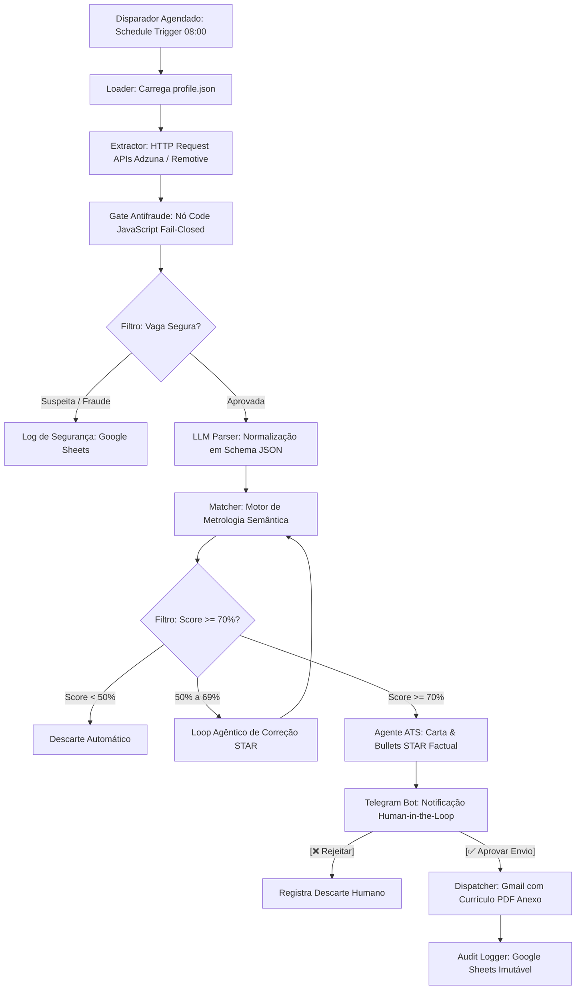

# Desafio de Automação N8N — DIO Santander 2026
## Sistema Automatizado de Busca por Vagas, Match Assertivo e Envio Ético de Candidaturas (Perfil Mauricio Alves dos Santos)

Este repositório contém a entrega oficial do **Desafio de Automação no N8N** do programa **DIO Santander 2026**. O projeto estrutura um ecossistema industrial de **Busca Ativa 24/7**, triagem semântica metrológica e candidatura assistida por Inteligência Artificial para o perfil de **Mauricio Alves dos Santos** (Scheduler Sênior, Especialista em Operações de TI de Missão Crítica, Cloud & Automação Inteligente).

---

## 📋 Sumário do Desafio DIO (Passos 1, 2 e 3)

Em estrita conformidade com as diretrizes do Desafio DIO Santander, abaixo estão os blocos oficiais estruturados:

### 🧱 Passo 1: Definição da Automação

```text
Quero criar uma automação no N8N para busca ativa, triagem semântica e submissão assistida de candidaturas a vagas de emprego em operações de TI e missão crítica.

Público ou responsável:
Mauricio Alves dos Santos (Scheduler Sênior, Especialista em Orquestração de Workloads e Confiabilidade de Sistemas).

Resultado esperado:
Identificar oportunidades corporativas altamente aderentes ao perfil (score >= 70%), bloquear sumariamente vagas fraudulentas ou suspeitas em modo fail-closed, gerar resumo profissional e carta de apresentação otimizados para filtros ATS sem nenhuma informação inventada, e solicitar aprovação humana via Telegram antes de qualquer envio de e-mail ou registro em planilha de auditoria.
```

---

### 🧱 Passo 2: Contexto e Regras

```text
Ferramentas envolvidas:
N8N (Orquestrador de Workflows), APIs Públicas de Empregos (Adzuna / Remotive / Jooble), OpenAI GPT-4o / Anthropic (LLM Parser e Otimizador ATS), Nó de Código JavaScript (Motor Antifraude e Similaridade Semântica), Telegram Bot API (Aprovação Interativa Human-in-the-Loop), Gmail / SMTP Node (Despachante Oficial de E-mails) e Google Sheets API (Auditoria e Rastreabilidade).

Fluxo desejado:
1. Disparador temporal agendado (Schedule Trigger) roda de segunda a sexta-feira às 08:00.
2. O sistema carrega os parâmetros de calibração do candidato a partir de um contrato técnico (profile.json).
3. O nó de integração consome vagas em endpoints oficiais via HTTP Request filtrando pelos termos-chave de missão crítica (Control-M, TSM, Mainframe, SRE, Scheduler).
4. O nó Code executa a barreira de segurança cibernética (Fail-Closed Antifraud Gate): descarta vagas com domínios de e-mail gratuitos para cargos corporativos, sites com menos de 30 dias de registro (WHOIS) ou menções a taxas/cobranças.
5. As vagas legítimas passam por um nó de IA (LLM Parser) que extrai e normaliza as atribuições em um schema estruturado (cargo, senioridade, stack, modalidade, requisitos mandatórios).
6. O nó de Similaridade Semântica calcula a distância métrica e o Match Score (0 a 100%) confrontando a vaga com as hard skills consolidadas de Mauricio (30 anos de experiência) e suas certificações recentes em Cloud e IA.
7. Se o Match Score for inferior a 50%, a vaga é descartada; se estiver entre 50% e 70%, entra em Loop Agêntico de Correção para reavaliação de sinônimos técnicos e alinhamento STAR; se for superior a 70%, avança como Candidatura Prioritária.
8. Para as vagas prioritárias, o Agente de Carreira contextualiza a Carta de Apresentação e destaca 3 conquistas reais (Método STAR) do histórico do candidato (TIVIT, IBM, Unilever, Rhodia, Comgás).
9. O N8N envia um card interativo no Telegram do candidato com o resumo da vaga, score e botões [Aprovar Envio] e [Rejeitar Vaga].
10. Mediante o clique em "Aprovar Envio", o nó de e-mail transmite a candidatura oficial com o currículo em anexo e o nó do Google Sheets registra a data, empresa, cargo e score na planilha imutável de auditoria.

Regras importantes:
- Princípio da Veracidade Absoluta: É terminantemente proibido inventar habilidades, experiências, datas ou ferramentas não presentes no histórico verificado do candidato.
- Filosofia Fail-Closed: Qualquer inconsistência cadastral, domínio recém-criado ou solicitação de dados sensíveis na fase inicial acarreta o bloqueio sumário da vaga.
- Human-in-the-Loop Obrigatório: Nenhuma candidatura é transmitida sem a confirmação explícita do candidato no Telegram, prevenindo qualquer envio indiscriminado ou spam.
- Conformidade ToS e LGPD: Operação estritamente amparada em APIs públicas legítimas com minimização e proteção dos dados pessoais do candidato.
```

---

### 🧱 Passo 3: Prompt Final Estruturado para o N8N

```text
Atue como um especialista em N8N.
Crie uma automação para busca ativa, triagem semântica e submissão assistida de candidaturas a vagas de emprego em operações de TI e missão crítica.

Público:
Mauricio Alves dos Santos (Scheduler Sênior, Especialista em Orquestração de Workloads e Confiabilidade de Sistemas).

Ferramentas envolvidas:
N8N, APIs Públicas de Empregos (Adzuna / Remotive), OpenAI / Modelos de Linguagem, Nó de Código JavaScript, Telegram Bot API, Gmail / SMTP Node e Google Sheets API.

Fluxo:
1. Disparo agendado às 08:00 em dias úteis pelo nó Schedule Trigger.
2. Ingestão de vagas via nós HTTP Request consumindo APIs de emprego com filtros parametrizados.
3. Triagem de segurança no nó Code eliminando golpes, domínios gratuitos e cobranças em modo fail-closed.
4. Normalização das descrições em Schema JSON por nó de LLM (OpenAI / Claude).
5. Cálculo de score de aderência semântica e metrológica confrontando a vaga com a bagagem de Mauricio Santos.
6. Ramificação condicional (If): vagas com score >= 70% são selecionadas para otimização ATS sem invenção de dados.
7. Notificação com botões interativos via Telegram Bot solicitando aprovação do candidato.
8. Envio do e-mail oficial com currículo em anexo via Gmail Node após aprovação.
9. Registro de rastreabilidade e auditoria no Google Sheets.

Regras:
- Rastreabilidade total de todas as interações.
- Bloqueio imediato de qualquer vaga com red flags de fraude (whois < 30 dias, e-mails genéricos, cobrança de taxas).
- Fidelidade factual irrestrita: nenhuma informação profissional fictícia pode ser gerada.
- Controle humano ativo (Human-in-the-Loop) antes de qualquer disparo externo.

Explique quais nós do N8N devem ser utilizados e a lógica de funcionamento do workflow.
```

---

## 🏗️ Arquitetura Detalhada da Solução



---

## ⚙️ Mapeamento dos Nós do N8N e Lógica de Funcionamento

| Nó N8N | Tipo Oficial | Função no Workflow | Lógica Operacional |
| :--- | :--- | :--- | :--- |
| **1. Disparador Agendado** | `n8n-nodes-base.scheduleTrigger` | Gatilho temporal | Dispara o workflow automaticamente de segunda a sexta-feira às 08h00 da manhã (`0 8 * * 1-5`). |
| **2. Loader: profile.json** | `n8n-nodes-base.code` | Injeção de contexto | Carrega as credenciais, competências centrais (Control-M, TSM, Mainframe) e limites de score do candidato. |
| **3. Extractor: APIs de Vagas** | `n8n-nodes-base.httpRequest` | Coleta estruturada | Faz requisições GET às APIs oficiais (Adzuna / Remotive), evitando raspagem agressiva e respeitando rate limits. |
| **4. Gate Antifraude** | `n8n-nodes-base.code` | Segurança cibernética | Executa validação *Fail-Closed*: verifica idade de domínio (<30 dias), e-mails corporativos não genéricos e termos de cobrança. |
| **5. Filtro: Vaga Segura?** | `n8n-nodes-base.if` | Roteamento de segurança | Vagas reprovadas são desviadas para log de anomalias; vagas aprovadas seguem no pipeline. |
| **6. LLM Parser** | `n8n-nodes-base.openAi` | Normalização semântica | Processa o texto bruto da vaga e gera um objeto JSON estrito com requisitos obrigatórios, opcionais e nível de criticidade. |
| **7. Matcher: Metrologia** | `n8n-nodes-base.code` | Cálculo de assertividade | Cruza o vetor de habilidades da vaga com os 30 anos de bagagem do candidato, calculando um índice matemático de 0 a 100%. |
| **8. Filtro: Score >= 70%?** | `n8n-nodes-base.if` | Triagem de alta conversão | Garante que apenas vagas com alta compatibilidade gerem ações e notificações, eliminando ruído. |
| **9. Agente ATS Tailor** | `n8n-nodes-base.openAi` | Otimização sem alucinação | Customiza a carta de apresentação sob o método STAR destacando vivências em contas estratégicas (TECBAN, ENEL, Unilever). |
| **10. Telegram Bot** | `n8n-nodes-base.telegram` | *Human-in-the-Loop* | Envia mensagem interativa com botões inline (`Aprovar` / `Rejeitar`), retendo a ação até o comando do usuário. |
| **11. Dispatcher: Gmail** | `n8n-nodes-base.gmail` | Submissão da candidatura | Dispara o e-mail formal de inscrição contendo o currículo oficial `curriculo_ats_mauricio_santos.pdf` em anexo. |
| **12. Audit Logger** | `n8n-nodes-base.googleSheets` | Auditoria e governança | Grava linha imutável com data, empresa, cargo, score e status da candidatura para acompanhamento. |

---

## 📂 Estrutura de Arquivos Deste Repositório

- **`README.md`**: Este documento mestre com os Passos 1, 2 e 3 do Desafio DIO, arquitetura e especificação de nós.
- **`workflow_n8n_vagas_assertivas.json`**: Arquivo JSON exportável do N8N pronto para importação via menu *Workflows > Import from File*.
- **`profile.json`**: Contrato de calibração do candidato contendo as competências e critérios técnicos.
- **`curriculo_ats_mauricio_santos.md`**: Versão em Markdown de coluna única, de alta densidade semântica e método STAR para triagem ATS.
- **`carta_apresentacao_alto_impacto.md`**: Carta de apresentação de alto impacto posicionando Mauricio como líder de infraestruturas híbridas e missão crítica.
- **`guia_confiabilidade_antifraude.md`**: Checklist completo de defesa antifraude, detecção de golpes e diretrizes LGPD.

---

## 🚀 Como Executar o Workflow no seu N8N

1. Abra sua instância local ou em nuvem do **N8N** (versão 1.x ou superior).
2. Clique em **Workflows** no menu lateral esquerdo e selecione **Add Workflow**.
3. No canto superior direito, clique nos três pontinhos (`...`) e selecione **Import from File**.
4. Escolha o arquivo `workflow_n8n_vagas_assertivas.json` localizado neste repositório.
5. Configure suas credenciais de ambiente:
   - `ADZUNA_APP_ID` e `ADZUNA_APP_KEY` (no nó HTTP Request);
   - `OPENAI_API_KEY` (no nó OpenAI);
   - Credencial do Telegram Bot via BotFather (`TELEGRAM_CHAT_ID`);
   - Credencial do Gmail OAuth2 e Google Sheets.
6. Ative o botão **Active** no topo do workflow para rodar no agendamento automático ou clique em **Test step** para homologação manual!
