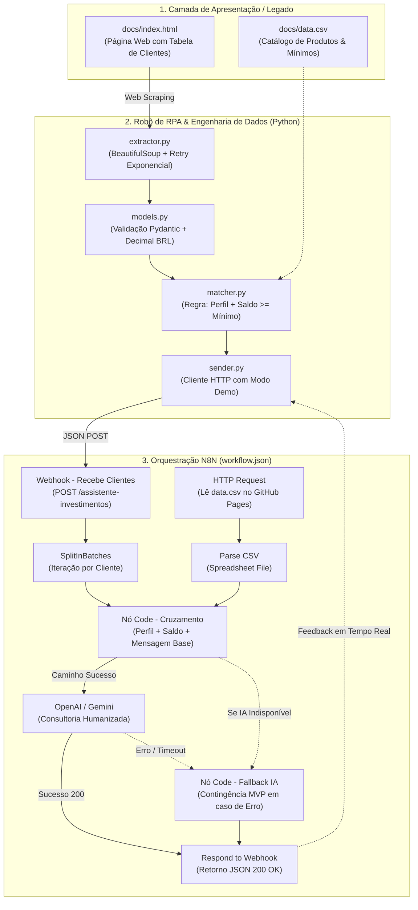

# 🤖 Assistente de Investimentos com RPA e IA Generativa
### DIO Santander Bootcamp 2026 — Desafio de Automação com N8N, Python & IA


---

## 📌 Visão Geral do Projeto

Este projeto implementa a solução de ponta a ponta para o desafio **"Criando um Assistente de Investimentos com RPA e IA Generativa"**, promovido pela **DIO (Digital Innovation One)** em parceria com o **Banco Santander**.

A interface do portal foi refinada para um **Terminal Financeiro Quant Futurista** (estilo Bloomberg/TradingView Institucional), incorporando **6 zonas visuais com Motion Graphics em movimento contínuo (60 FPS)**, unindo:
1. **Extração de Dados em Tempo Real (RPA)** de uma base de clientes legada via Web Scraping com Python e BeautifulSoup.
2. **Orquestração e Processamento** no **N8N** via Webhook.
3. **Cruzar perfis de investidor** com o catálogo oficial de opções de investimento (`data.csv`).
4. **Gerar recomendações personalizadas** em duas camadas (MVP Estático e IA Generativa com LLM).
5. **Painel com 6 Elementos Gráficos em Movimento**: Candlestick em Canvas 60 FPS, Trend Spline com Glow, Marcadores de Radar, Barras de Volume, Cotações com Flash 400ms e Profundidade de Livro de Ofertas (Depth Bars).Fallback

---

## 🏗️ Arquitetura da Solução e Fluxo de Fallback



---

## 📂 Estrutura Refinada do Repositório

```text
dio-lab-assistente-investimentos-rpa-n8n/
├── .env.example                         # Variáveis de ambiente configuráveis
├── .gitignore                           # Proteção de credenciais e caches
├── requirements.txt                     # Dependências com versões fixadas
├── README.md                            # Documentação técnica e guia de execução
├── src/
│   ├── __init__.py                      # Módulo Python estruturado
│   ├── config.py                        # Centralização de configurações (.env)
│   ├── models.py                        # Schemas Pydantic & parsers monetários
│   ├── extractor.py                     # RPA com BeautifulSoup e retries
│   ├── investments.py                   # Loader do CSV de investimentos
│   ├── matcher.py                       # Regra de negócio (Perfil + Saldo)
│   ├── sender.py                        # Cliente HTTP robusto para N8N
│   ├── extrair_clientes.py              # Entrypoint CLI principal
│   └── extrair_clientes.ipynb           # Notebook interativo para Google Colab
├── tests/
│   └── test_assistente.py               # Testes unitários automatizados
├── n8n/
│   ├── workflow.json                    # Workflow com nós estáveis e Fallback IA
│   └── workflow_ia_openai_gemini.json   # Variação com nós LangChain
└── docs/
    ├── index.html                       # Base web de clientes
    └── data.csv                         # Matriz oficial de produtos de investimento
```

---

## 🛡️ Diagnóstico e Refinamento de Engenharia

| Problema Identificado | Impacto Operacional | Ação de Refinamento Implementada |
| :--- | :--- | :--- |
| **URLs e Webhook hardcoded** | Dificulta deploy e versionamento | Configuração centralizada via `.env` (`src/config.py`) |
| **Parsing de saldo com regex simples** | Quebrava em múltiplos pontos (`R$ 1.234.567,89`) | Parser monetário com `Decimal` e validador Pydantic |
| **Dependência exclusiva de Notebook** | Incompatível com CI/CD e cron jobs | Pacote modular executável via CLI (`src/extrair_clientes.py`) |
| **Falta de validação de schema** | Dados corrompidos propagavam silenciosamente | Modelos estritos Pydantic (`Cliente`, `Investimento`, `Recomendacao`) |
| **Página sem `<tbody>` ou encoding irregular** | Falha de extração em páginas legadas | Parser dinâmico (`find_all('tr')`) com suporte UTF-8 explícito |
| **CSV com BOM (`\ufeff`)** | Coluna inicial inválida na leitura | Sanitização via `lstrip('\ufeff')` |
| **Possível indisponibilidade da IA/N8N** | Falha total da esteira bancária | Ramo de **Fallback Automático (MVP)** no n8n e modo demo no Python |

---

## 📊 Matriz Oficial de Investimentos (`docs/data.csv`)

| Perfil | Produto | Aporte Mínimo (R$) | Rentabilidade Projetada |
| :--- | :--- | :--- | :--- |
| **Conservador** | Poupança | R$ 100,00 | 6.2% a.a. |
| **Conservador** | Tesouro Selic | R$ 500,00 | 13.0% a.a. |
| **Conservador** | CDB Liquidez Diária | R$ 1.000,00 | 12.5% a.a. |
| **Moderado** | CDB Prefixado | R$ 1.000,00 | 14.0% a.a. |
| **Moderado** | Tesouro IPCA+ | R$ 1.000,00 | IPCA + 6.0% a.a. |
| **Moderado** | Fundo Multimercado | R$ 5.000,00 | 16.0% a.a. |
| **Arrojado** | Criptomoedas | R$ 100,00 | Variável |
| **Arrojado** | Ações ETF | R$ 500,00 | Variável |
| **Arrojado** | Fundo de Ações | R$ 10.000,00 | Variável |

> **Regra de Elegibilidade Chave**: Um cliente só recebe recomendação se `saldo >= minimo`. Por exemplo, um cliente Conservador com saldo de R$ 350,00 recebe recomendação de **Poupança (mín. R$ 100)**, mas não de **Tesouro Selic (mín. R$ 500)** ou **CDB (mín. R$ 1.000)**. Se o saldo for inferior a todos os mínimos, o sistema emite orientação clara para aportes adicionais.

---

## 🚀 Como Executar o Projeto

### 1. Execução Local via Terminal (Python Standalone)

```bash
# 1. Clone o repositório
git clone https://github.com/<seu-usuario>/dio-lab-assistente-investimentos-rpa-n8n.git
cd dio-lab-assistente-investimentos-rpa-n8n

# 2. Crie e ative o ambiente virtual
python -m venv .venv
# Windows:
.venv\Scripts\activate
# Linux/macOS:
source .venv/bin/activate

# 3. Instale as dependências
pip install -r requirements.txt

# 4. Configure o arquivo de ambiente
copy .env.example .env

# 5. Execute o script principal
python -m src.extrair_clientes
```

### 2. Execução Interativa no Google Colab (`src/extrair_clientes.ipynb`)

O notebook foi desenvolvido especificamente para apresentações e defesas técnicas com **interface visual rica**:
- Barras de progresso com `tqdm` para extração e pipeline geral;
- **Styled DataFrames** com realce de saldo e ícones de perfil;
- **Cards HTML/CSS** coloridos dinamicamente por perfil de investidor;
- Widgets interativos (`ipywidgets`) para seleção entre **Modo Demonstração (sem N8N)** e **Modo Produção (Webhook + IA)**;
- Botão de download automático das recomendações em formato CSV (`recomendacoes_investimentos.csv`).

Para executar:
1. Abra o arquivo `src/extrair_clientes.ipynb` no [Google Colab](https://colab.research.google.com/);
2. Execute as células sequencialmente de 1 a 10.

### 3. Execução dos Testes Automatizados

O repositório inclui suite de testes unitários cobrindo parsing monetário, filtros de perfil, ordenação por aporte mínimo e contingência:

```bash
python -m unittest discover tests
```

---

## ⚙️ Deploy e Configuração do N8N (`n8n/workflow.json`)

1. Abra sua instância do **N8N** (Cloud ou Local).
2. Vá em **Workflows** → **Add Workflow** → menu superior (`...`) → **Import from File**.
3. Selecione o arquivo [`n8n/workflow.json`](file:///c:/Users/rodri/Desktop/CURSO%20AWS%20%20%20AZ%20900%20%20TIVIT/DIO.Santander%202026_Automa%C3%A7%C3%A3o%20com%20N8N/Desafio%20N8N/dio-lab-assistente-investimentos-rpa-n8n/n8n/workflow.json).
4. No nó **HTTP - Ler CSV Investimentos**, aponte para a URL do seu GitHub Pages (`data.csv`).
5. No nó **OpenAI - Mensagem Personalizada**, vincule sua credencial (ou substitua pelo nó do Google Gemini com `gemini-1.5-flash`).
6. Ative o workflow (**Activate**) e copie a **Production URL** do nó Webhook.
7. Insira a URL no seu `.env` na variável `WEBHOOK_N8N`.

---

## 💬 Exemplo de Recomendações Geradas

Para o cliente **Mariana Rios de Souza** (Perfil: Moderado | Saldo: R$ 15.000,00):

### 🔹 Mensagem Estática Determinística (MVP / Fallback de Contingência)
> *"Olá Mariana Rios de Souza, com base no seu perfil Moderado (equilíbrio entre segurança e rentabilidade) e saldo de R$ 15.000,00, recomendamos:*  
> *• CDB Prefixado — rentabilidade 14.0% (mín. R$ 1.000,00)*  
> *• Tesouro IPCA+ — rentabilidade IPCA+6.0% (mín. R$ 1.000,00)*  
> *• Fundo Multimercado — rentabilidade 16.0% (mín. R$ 5.000,00)"*

### 🔹 Mensagem Humanizada com IA Generativa (OpenAI GPT-4o-mini / Gemini)
> *"Prezada Mariana Rios de Souza,*  
>  
> *Com base em sua carteira atual e no seu perfil Moderado, você possui um excelente capital disponível (R$ 15.000,00) para estruturar uma carteira eficiente e diversificada:*  
>  
> *🎯 Alocação Sugerida:*  
> *• [CDB Prefixado & Tesouro IPCA+]: Garantem previsibilidade de ganhos e proteção real do poder de compra contra a inflação.*  
> *• [Fundo Multimercado]: Agrega gestão ativa e potencial de ganho excedente sobre a taxa básica de juros.*  
>  
> *Seu saldo cobre todos os aportes mínimos exigidos. Conte conosco para realizar as alocações diretamente em seu app Santander.*  
>  
> *Atenciosamente,*  
> *Sua Assessoria de Investimentos Santander"*

---

## 👨‍💻 Autor & Bootcamp

- **Desafio**: Assistente de Investimentos com RPA e IA Generativa
- **Bootcamp**: DIO Santander Bootcamp 2026
- **Engenharia**: Python 3.10+, Pydantic v2, BeautifulSoup4, N8N, Pandas, OpenAI & Google Gemini.
